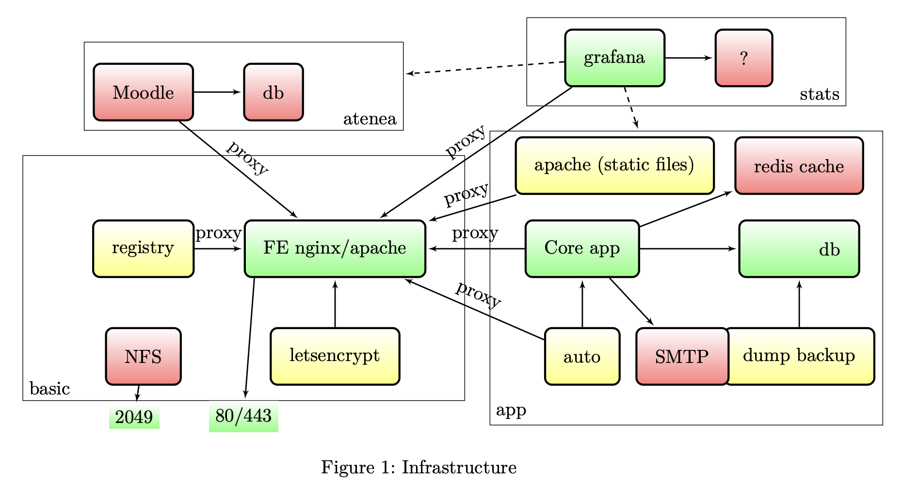
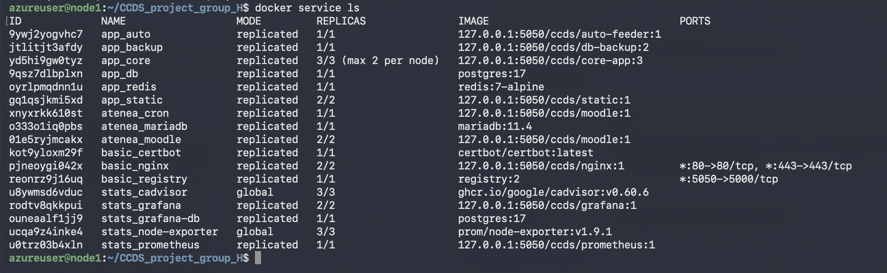

# Cloud Computing and Distributed Systems Short Project – Group H

By:
* Alvaro Castillejo
* Berk Gonenc
* Sepehr Ashtari
* Abdelkrim Alahyane

---

## Contents

1. [Overview](#overview)
2. [Run locally](#run-locally)
3. [Architecture](#architecture)
4. [Stacks](#stacks)
    - [Basic – Front end and infrastructure](#basic--front-end-and-infrastructure)
    - [App – Rating application](#app--rating-application)
    - [Stats – Monitoring](#stats--monitoring)
    - [Atenea – Moodle](#atenea--moodle)
5. [Production deployment (Docker Swarm on Azure)](#production-deployment-docker-swarm-on-azure)
6. [Data management and backups](#data-management-and-backups)
7. [Scalability](#scalability)
8. [Security](#security)
9. [Evidences](#evidences)
10. [Known limitations](#known-limitations)
11. [Repository layout](#repository-layout)

---

## Overview

The project is divided into four stacks, all reached through one nginx front end:

| Stack | Services | Purpose |
|---|---|---|
| `basic` | nginx, certbot (Let's Encrypt), registry, NFS | Shared services for the whole infrastructure |
| `app` | core (Python), Postgres, Redis, Apache static, feeder bot, DB backup, SMTP relay (Mailpit) | "Page ratings" application |
| `stats` | Prometheus, cAdvisor, node-exporter, Grafana (+ Infinity plugin) | Monitoring of every container, node and the app |
| `atenea` | Moodle 5.3, MariaDB, Moodle cron | Learning Management System |

Each stack has two compose files, as required:

- `compose.yml` – **local** environment: one machine, no TLS, no shared volumes, plain local passwords.
- `production.yml` – **production**: Docker Swarm, replicas, Docker secrets, overlay networks, NFS.

---

## Run locally

**Requirements:** Docker (running) and `make`. To start the environment locally execute the following command:

```bash
make local-up
```

What happens:

- Missing secret files are created automatically from the `.example` files.
- All four stacks are built and started; only nginx publishes a port (80).
- Wait around 2 minutes. **Moodle installs itself on the first start (up to 5 minutes).**
- Check progress with `make status`.

The different stacks are reachable from the following URLs:

| URL | What | Login (local only) |
|---|---|---|
| http://app.localhost | Core app API (JSON, shows which replica answered) | n/a |
| http://app.localhost/static/ | Rate a page and see the live leaderboard | n/a |
| http://grafana.localhost | Grafana, dashboard "CCDS overview" (folder CCDS) | `admin` / `admin` |
| http://moodle.localhost | Moodle LMS | `admin` / `Atenea-Admin1` |
| http://mail.localhost | Mailbox: an alert arrives for every 1-star rating | n/a |

Every other service is reachable only through nginx. The `make` commands for the local environment are:

```bash
make status                    # check container status
make local-down                # stop containers but keep data
make local-clean               # stop containers and delete all data
HTTP_PORT=8081 make local-up   # if port 80 is busy indicate desired port -> http://app.localhost:8081
```

**Quick demo:** after `make local-up` rate a page with 1 star on http://app.localhost/static/ → the leaderboard updates →
an alert mail appears at http://mail.localhost → the rating shows up in Grafana's "Ratings per minute" panel.

---

## Architecture



**Request path:** browser → nginx (`<service>.<domain>`) → service on the shared `proxy` network.

**Networks**

| Network | Type | Who is on it | Why |
|---|---|---|---|
| `proxy` | external, overlay (attachable) in swarm | nginx + every service nginx routes to | Single shared contract between stacks |
| `app_backend` | overlay, `internal` | core, Postgres, Redis, feeder, backup, smtp | Database and cache unreachable from nginx and from the internet |
| `atenea_backend` | overlay, `internal` | Moodle, MariaDB, cron | Same for the LMS |
| `stats_monitoring` | overlay, `internal` | Prometheus, Grafana, grafana-db, exporters | Monitoring internals isolated |

**Routing (nginx)** – one template per subdomain in `basic/nginx/templates/`, with `${DOMAIN}`
filled in at start (`localhost` locally, `ccds-group-h.duckdns.org` in production):

| Host | Upstream |
|---|---|
| `app.<domain>/` and `/app/` | `core:8000` |
| `app.<domain>/static/` | `static:80` |
| `grafana.<domain>` | `grafana:3000` (incl. websockets for Grafana Live) |
| `moodle.<domain>` | `moodle:80` |
| `registry.<domain>/v2/` | `registry:5000` (basic auth) |
| `mail.<domain>` | `smtp:8025` (Mailpit web mailbox, local demo only) |

nginx resolves upstreams per request through Docker's DNS (`resolver 127.0.0.11`), so it starts even
when the other stacks are not deployed yet (it answers 502 until they are).

---

## Stacks

### Basic – Front end and infrastructure

Files: `basic/`, `scripts/`, `Makefile`.

- **Nginx** (`basic/nginx/`): image configuration (one template per subdomain plus
  snippets), 2 replicas in production. The script `30-tls-mode.sh` runs at start-up:
  - no certificate (local, or before the first issue) → **HTTP mode**, port 80;
  - certificate present → **HTTPS mode**, port 443 with HTTP/2, and port 80 only answers the
    Let's Encrypt and redirects everything else to HTTPS;
  - it checks the certificate file every minute and reloads nginx when it appears or changes.
- **Let's Encrypt** (`certbot` service): one certificate for `app.`, `grafana.`, `moodle.` and `registry.`,
  using the HTTP-01 webroot challenge. It runs `certbot certonly --keep-until-expiring` in a loop every
  12 hours, so the same command issues and renews. Certificates and the challenge folder are on NFS, so
  every nginx replica on every node uses them. Tested first with `LETSENCRYPT_STAGING=1` (rate limits).
- **Registry** (`registry:2`): images are stored on NFS.
  - Inside the swarm: `127.0.0.1:5050` on every node (routing mesh), so pushing and pulling need no TLS.
    Port 5050 is **not** open in the Azure firewall.
  - From outside: `https://registry.<domain>` through nginx, protected with basic auth
    (password file passed as a Docker secret, never in git).
- **NFS:** server on node1 (`/srv/nfs`), exported only to the private network `172.16.0.0/16`, and
  mounted on every node at `/mnt/nfs`. Used by Docker volumes with the `nfs` driver (registry,
  certificates, moodledata) and by the app backup job. Setup: `scripts/nfs-server.sh`.
- **Makefile:** the single entry point – `local-up` / `local-down` / `local-clean` / `status` locally,
  `registry` / `release` / `deploy` on the swarm.

### App – Rating application

Files: `app/`.

The application lets users rate web pages from 1 to 5 stars and displays a live leaderboard.

| Service | Image | Replicas | Purpose |
|---|---|---:|---|
| Core | `ccds/core-app:3` (Flask + gunicorn) | 3 | Handles ratings, leaderboard, alerts and metrics |
| Static | `ccds/static:1` (Apache httpd) | 2 | Serves the website with the rating form |
| Auto-feeder | `ccds/auto-feeder:1` | 1 | Automatically submits a fake rating every 5 s |
| PostgreSQL | `postgres:17` | 1 | Stores ratings (critical data) |
| Redis | `redis:7-alpine` | 1 | Caches the leaderboard for 30 s (no persistence) |
| Backup | `ccds/db-backup:2` | 1 | `pg_dump` every hour to NFS, keeps the last 48 |
| SMTP (Mailpit) | `axllent/mailpit` | 1 | Relays alert mails; locally keeps them in a web mailbox |

**Core API**

| Method | Path | What it does |
|---|---|---|
| GET | `/` | Returns the hostname of the replica that answered (shows load balancing) |
| GET | `/health` | Liveness check; also reports db and redis status |
| POST | `/ratings` | Body `{"page": "...", "stars": 1-5, "comment": "..."}` |
| GET | `/leaderboard` | Top 10 pages by average rating (Redis cache, 30 s) |
| GET | `/metrics` | Prometheus counters: `ratings_total{stars}`, `leaderboard_cache_hits_total` |

**Design points**

- **Rating form:** the static page posts to the core API (`/app/ratings`) and refreshes the leaderboard
  every 10 s. Rows are built with `textContent`, so user input is never interpreted as HTML.
- **SMTP:** a 1-star rating makes the core app send an alert mail to the `smtp` service (Mailpit).
  Locally Mailpit keeps the mails in a web mailbox (http://mail.localhost); in production it can forward
  them to a real provider with its `MP_SMTP_RELAY_*` settings. Mail is best effort: an SMTP failure never
  breaks a rating.
- **Stateless core:** one gunicorn worker per container (non-root user); scaling means more replicas.
- **Health check is liveness only:** `/health` stays healthy when the database is down, because
  restarting app replicas cannot fix a database and would cause a restart loop. Database errors become a
  clear `503`, and if Redis is down the leaderboard is read straight from Postgres.
- **Rolling updates:** one replica at a time, the new one started before the old one stops
  (`start-first`), automatic rollback if the new version is unhealthy within 30 s.

### Stats – Monitoring

Files: `stats/`.

| Service | Replicas | Purpose |
|---|---:|---|
| Prometheus | 1 | Collects monitoring data (time-series database) |
| cAdvisor | 1 per node | CPU, memory and network of every container |
| Node Exporter | 1 per node | CPU, memory and disk of every machine |
| Grafana | 2 | Displays dashboards |
| Grafana DB | 1 | Shared Postgres for Grafana users and sessions |

- **Observability as code:** nothing is configured by clicking in the UI. Datasources, dashboards and the
  plugin are files configured into the image, and UI edits are disabled:

  | File | What it defines |
  |---|---|
  | `prometheus/prometheus.yml` / `prometheus.local.yml` | What to scrape in swarm (`tasks.*` DNS) / locally |
  | `grafana/provisioning/datasources/datasources.yml` | Prometheus + App API datasources |
  | `grafana/provisioning/dashboards/dashboards.yml` | Loads every JSON dashboard into folder "CCDS" |
  | `grafana/dashboards/ccds-overview.json` | The dashboard |
  | `grafana/Dockerfile` | Grafana version + plugin version |

- **Plugin – Infinity:** turns any HTTP API into a Grafana datasource. It reads the core app's
  `/leaderboard`, so the dashboard shows **business data** (best rated pages, live) next to the technical
  metrics, without any exporter or extra code in the app. Installed at build time, limited by
  `allowedHosts` to the app's URL.
- **Dashboard "CCDS overview":** core replicas up · ratings in the last hour · cache hits/min · swarm nodes
  reporting · ratings per minute by stars · live leaderboard (Infinity) · CPU and memory per container ·
  CPU per node.
- **Design notes:**
  - Prometheus scrapes `tasks.app_core`, which returns **every** replica's IP (a plain service name
    load-balances to a random replica, so counters would jump around).
  - cAdvisor and node-exporter run in `mode: global`: one copy per node, new nodes get them automatically.
  - Grafana can run 2 replicas because they share `grafana-db`; with the default SQLite each replica
    would have its own sessions and the load balancer would log users out.
  - Grafana's memory limit (512 MB) was measured with cAdvisor (~430 MB idle); a first guess of 256 MB
    would have made Swarm kill it in a loop.

### Atenea – Moodle

Files: `atenea/`

| Service | Replicas | Purpose |
|---|---:|---|
| Moodle | 2 | Learning management system (Moodle 5.3, PHP 8.3 + Apache) |
| MariaDB | 1 | Stores Moodle data (MariaDB 11.4, utf8mb4) |
| Cron | 1 | Runs scheduled Moodle tasks every minute (production) |

- **No installation wizard:** `moodle-entrypoint.sh` runs Moodle's command-line installer on the first
  start (admin user, database, site name), so `make local-up` gives a ready-to-use Moodle.
- **Survives container recreation:** the generated `config.php` is saved in the moodledata volume and
  restored when the container is recreated, so Moodle is never installed twice.
- **Multiple replicas:** both instances share moodledata (NFS in production). A lock directory on the
  shared volume makes sure only one replica installs; the other waits and reuses its configuration.
- **HTTPS:** nginx handles TLS; in production `MOODLE_SSLPROXY=1` adds `$CFG->sslproxy = true` so Moodle
  generates `https://` links.
- **Secrets:** production passwords come from Docker secrets (`*_FILE` variables).
- **Moodle 5.x layout:** the web root is `public/`, so Apache's document root is changed in the Dockerfile.

---

## Production deployment (Docker Swarm on Azure)

### Cluster

| | |
|---|---|
| Provider | Azure for Students, region France Central |
| Nodes | 3 × Standard B2als_v2 (2 vCPU, 4 GB), Ubuntu 24.04, one virtual network |
| node1 `172.16.0.4` | swarm manager, NFS server, the only node with HTTP/HTTPS open |
| node2 `172.16.1.4` | worker, labelled `db=true` (Postgres and MariaDB run here) |
| node3 `172.16.2.4` | worker |
| Domain | `ccds-group-h.duckdns.org` (DuckDNS, `*.` subdomains → node1) |

Node setup and swarm creation: `scripts/swarm-up.sh`. NFS server: `scripts/nfs-server.sh`.

### Deploy

On node1, from the repository:

```bash
# Execute only the first time before the images can be pushed
make registry
# Build all images and push them to the registry, then deploy the 4 stacks
make release
make deploy
```

Before the first deploy: real passwords in `app/secrets/`, `stats/secrets/`, `atenea/secrets/` and
`basic/registry/htpasswd` (never committed), NFS folders created and mounted at `/mnt/nfs` on every
node, node2 labelled `db=true`.

Images are always built on node1 (x86): images built on an Apple Silicon Mac would be ARM.

### Update and roll back

```bash
git pull && make release && make deploy     # rolling update, one replica at a time
docker service scale app_core=5             # scale a service
docker service rollback app_core            # go back to the previous version
docker service ps app_core                  # where each replica runs
```

- `make deploy` (`docker stack deploy`) looks up the new image even when the tag is the same;
  `docker service update --force` alone does **not** (it keeps the old image digest).
- Changing a Docker secret (e.g. the registry password) requires `docker stack rm <stack>` and a new deploy.

---

## Data management and backups

The question for every piece of data: *is it data at all, and is it critical?*

| Data | Kind | Local | Production | Backed up | If lost |
|---|---|---|---|---|---|
| Ratings (Postgres) | Critical | volume `app_db_data` | local volume on node2 (`db=true`) | **Yes**, hourly `pg_dump` to NFS, 48 kept | Restore last dump (`restore.sh`) |
| Moodle database (MariaDB) | Critical | volume `atenea_db_data` | local volume on node2 | Manual `mariadb-dump` (see below); not automated | Restore the last dump |
| Moodle files (moodledata) | Critical | volume `atenea_moodledata` | NFS `/srv/nfs/atenea/moodledata` | Manual `tar` of the NFS folder | Restore the archive |
| Alert mails (Mailpit) | Volatile | inside the container | inside the container | No | Only demo copies; real mail goes to the provider |
| Leaderboard cache (Redis) | Volatile | memory only | memory only | No | Rebuilt from Postgres |
| Metrics (Prometheus) | Nice to have | volume | local volume on the manager | No | Graphs restart, scraping refills |
| Grafana users/sessions | Low | SQLite volume | Postgres `grafana-db` | No | Users log in again |
| Dashboards, nginx config, code | Code | in images (git) | in images (git) | git | Rebuild and redeploy |
| TLS certificates | Regenerable | – | NFS | No | certbot issues new ones |
| Registry images | Regenerable | – | NFS | No | `make release` |
| Passwords | Secrets | `.txt` from `.example` | Docker secrets | No | Create new secret files |

**Why databases are not on NFS:** file locking on network filesystems can corrupt databases and makes
them slow. Databases stay on a local volume on a labelled node; their **dumps** go to NFS so they survive
the loss of that node.

### App database: automatic backup and restore

- `pg_dump` runs every hour (every minute locally) and writes
  `/mnt/nfs/app-backups/ratings-YYYYMMDD-HHMMSS.sql.gz`; only the newest 48 are kept.
- A dump is accepted only if `pg_dump` itself succeeded **and** the file contains PostgreSQL's
  "dump complete" marker, so a failed dump can never replace a good one.
- **RPO** (maximum data loss) = backup interval = 1 hour.

```bash
# Restore the newest valid dump
docker exec -it $(docker ps -q -f name=app_backup) restore.sh
# Restore a specific dump
docker exec -it $(docker ps -q -f name=app_backup) restore.sh ratings-20261011-145752.sql.gz
```

`restore.sh` checks the dump and the database login **before** deleting anything.
**If the database node dies:** label another node `db=true`, run `make deploy` again (Postgres starts
there with an empty volume), then run the restore command above.

### Moodle: manual backup

Only the app database has an automatic backup job, as required by the statement. Moodle is backed up by
hand; automating it would reuse the same pattern as `app/backup` (a cron container dumping to NFS).

```bash
# Local
docker exec atenea-mariadb-1 mariadb-dump -u root -prootpass --single-transaction moodle | gzip > moodle-db.sql.gz

# Production – database (on node2, where MariaDB runs)
docker exec $(docker ps -qf name=atenea_mariadb) sh -c \
  'mariadb-dump -u root -p"$(cat /run/secrets/moodle_db_root_password)" --single-transaction moodle' \
  | gzip > /mnt/nfs/moodle-db-$(date +%F).sql.gz
# Production – files (on node1)
sudo tar czf /srv/nfs/moodledata-$(date +%F).tar.gz -C /srv/nfs/atenea moodledata
```

---

## Scalability

The statement requires every service to be scalable, except cron jobs and DBMSs.

| Service | Replicas | Scales? |
|---|---|---|
| nginx | 2 | Yes |
| registry | 1 | Yes (storage on NFS) |
| certbot | 1 | No – cron job |
| core | 3 | Yes (stateless) |
| static | 2 | Yes |
| auto | 1 | Yes (more replicas = more traffic) |
| redis | 1 | One shared cache by design |
| postgres, mariadb, grafana-db | 1 | No – DBMS |
| backup, moodle cron | 1 | No – cron jobs |
| grafana | 2 | Yes (shared Postgres) |
| prometheus | 1 | No – time-series DBMS |
| cadvisor, node-exporter | global | One per node |
| moodle | 2 | Yes (shared moodledata, install lock) |
| smtp (Mailpit) | 1 | One mailbox by design (messages stored in the container) |

```bash
docker service scale app_core=5
```

---

## Security

- **Only 22, 80 and 443 are open from the internet**; NFS (2049), registry (5050) and swarm ports are
  reachable only inside the Azure virtual network (checked from outside: all closed).
- **HTTPS everywhere** in production, HTTP redirected to HTTPS.
- **Docker secrets** for every production password; only `.example` files are in git.
- **Internal networks** for databases and caches; nginx cannot reach them.
- **Registry** behind basic auth; **Grafana** admin password from a secret; **Infinity** limited to the app URL.
- **Mailbox** (`mail.<domain>`) is a local demo only: not covered by the certificate, not published in production.
- Containers run as non-root users where the image allows it (core, feeder, backup).

---

## Evidences

The docker swarm has been correctly deployed on Azure with the 3 nodes and all 18 services deployed as visible in the image below:



The screenshot has been taken from the node1 in the Docker Swarm where the deployment is performed.

Tests performed:

| Test | Result |
|---|---|
| `make local-up` from a fresh clone | all stacks up, every URL works, no manual step |
| 3-node swarm | `docker node ls`: 3 nodes Ready |
| Load balancing | `app.<domain>/` answered by 3 different replicas |
| HTTPS | valid Let's Encrypt certificate, HTTP → 301 HTTPS |
| Registry | `401` without password, `docker login` succeeds with it |
| Firewall (from outside) | 5050, 2049, 2377, 3000, 8080 closed |
| App backup and restore | table dropped and restored from the last dump |
| Grafana | 2 replicas, 10 of 10 requests with the same session cookie accepted |
| Moodle | installs itself, 2 replicas share one installation, no reinstall after restart |

---

## Known limitations

- **Single NFS server on node1:** if node1 fails, shared storage is unavailable. A replicated filesystem
  (GlusterFS, Longhorn) would remove this single point of failure.
- **Databases are single replicas on node2:** a node2 failure stops writes until the database is restored
  on another node.
- **Moodle backups are manual** (see [Data management](#data-management-and-backups)).
- **Mailpit** only forwards to a real mail provider once its `MP_SMTP_RELAY_*` credentials are configured.

---

## Repository layout

```
basic/     nginx (Dockerfile, templates/, snippets/, 30-tls-mode.sh), registry/   compose.yml, production.yml
app/       core/, auto/, static/, backup/, secrets/*.example                       compose.yml, production.yml
stats/     grafana/ (provisioning/, dashboards/), prometheus/, secrets/*.example    compose.yml, production.yml
atenea/    Dockerfile, moodle-entrypoint.sh, secrets/*.example                      compose.yml, production.yml
scripts/   swarm-up.sh, nfs-server.sh
Makefile   local-up, local-down, local-clean, status | registry, release, deploy
```